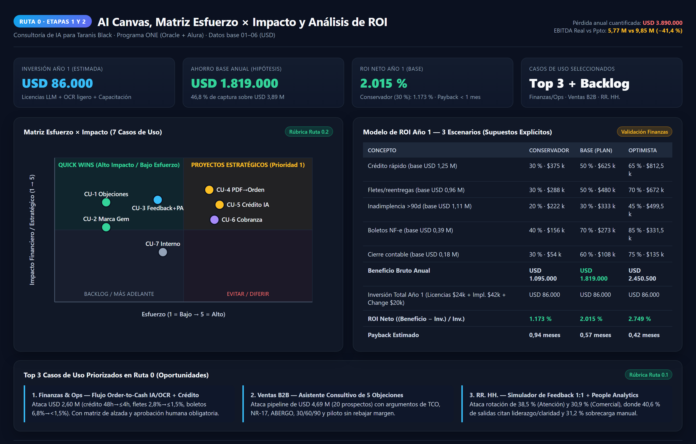
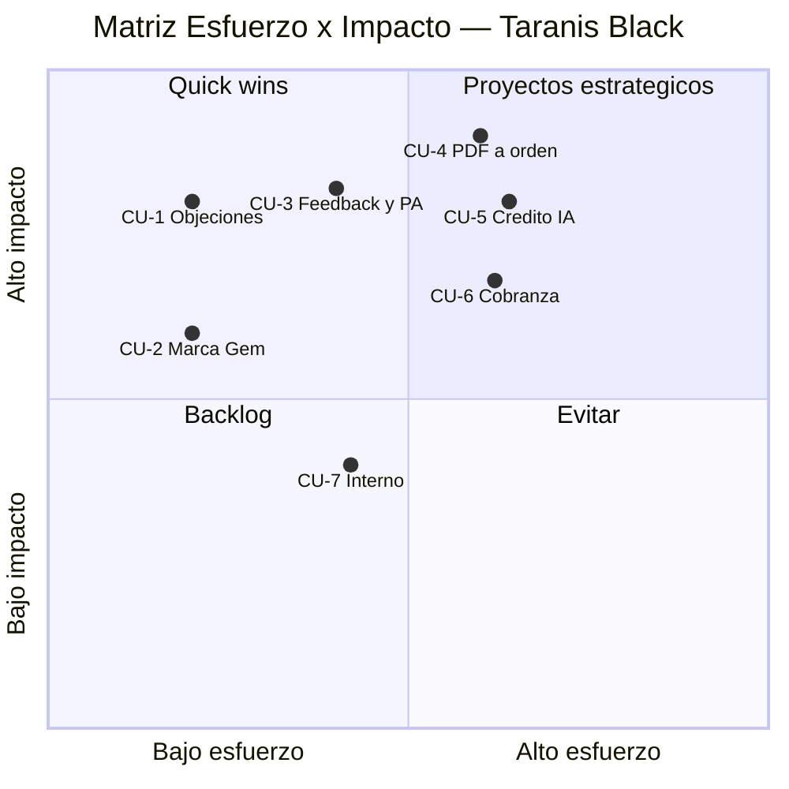

# Ruta 0 · Etapa 2 — Matriz Esfuerzo × Impacto, ROI y Gestión del Cambio

## 1. Matriz Esfuerzo × Impacto (1 = bajo, 5 = alto)
*El esfuerzo contempla calidad/disponibilidad de datos, integración con el ERP legado y gestión del cambio en los equipos.*

| ID | Caso de uso | Impacto | Esfuerzo | Cuadrante |
|---|---|---|---|---|
| **CU-4** *(Finanzas/Ops)* | Extracción PDF → orden de venta/expedición | **5** (≈ USD 1,35 M: fletes + boletos) | 3 | **Prioridad 1 (Estratégico)** |
| **CU-5** *(Finanzas)* | Pre-análisis de crédito con matriz de alzada | **5** (USD 1,25 M en pedidos salvados) | 3 | **Prioridad 1 (Estratégico)** |
| **CU-1** *(Ventas)* | Asistente consultivo de 5 objeciones | **4** (pipeline USD 4,69 M) | 1 | **Quick Win** |
| **CU-2** *(Marketing)* | Gem/GPT de marca para contenidos NR-17 | **3** (demanda B2B y marca) | 1 | **Quick Win** |
| **CU-3** *(RR. HH.)* | Simulador de Feedback 1:1 + People Analytics | **4** (rotación 22,86 % · 38,5 % Atención) | 2 | **Quick Win / Prioridad 2** |
| **CU-6** *(Finanzas)* | Cobranza automática (inadimplencia > 90 d) | **4** (USD 1,11 M en PDD) | 3 | **Prioridad 2** |
| **CU-7** *(Transversal)* | Asistente interno de onboarding y políticas | **2** (salidas < 90 días) | 2 | **Backlog / Más adelante** |

## 2. Análisis de ROI y Payback (Año 1)

### 2.1 Inversión estimada Año 1 (CAPEX + OPEX inicial)
| Partida de inversión | Detalle estimado | Costo anual (USD) |
|---|---|---|
| Licencias LLM corporativas (retención cero) | ~35 asientos clave (Comercial, Finanzas, RR. HH., Marketing, Gerencia) × USD 30/mes + API/OCR | **24.000** |
| Implementación, prompts, OCR ligero y flujos | Parametrización de validadores PDF→ERP, tablas de alzada y pruebas piloto (sin reemplazo total de ERP) | **42.000** |
| Capacitación, campeones y gobernanza LGPD | Talleres por área, simulador de feedback, auditoría inicial DPO y documentación POP | **20.000** |
| **Inversión Total Año 1** | | **USD 86.000** |

### 2.2 Escenarios de retorno económico (sobre USD 3,89 M de pérdidas cuantificadas)
*Fórmula:* $\text{ROI Neto (\%)} = \frac{\text{Beneficio Anual} - \text{Inversión}}{\text{Inversión}} \times 100$ · $\text{Payback (meses)} = \frac{\text{Inversión}}{\text{Beneficio Anual} / 12}$

| Palanca de valor (Kit Finanzas Hoja 3) | Pérdida actual (USD) | Conservador (captura) | Base / Plan (captura) | Optimista (captura) |
|---|---|---|---|---|
| Homologación de crédito (48 h → ≤ 4 h) | 1.250.000 | 30 % · USD 375.000 | 50 % · USD 625.000 | 65 % · USD 812.500 |
| Fletes de emergencia y reentregas | 960.000 | 30 % · USD 288.000 | 50 % · USD 480.000 | 70 % · USD 672.000 |
| Inadimplencia B2B > 90 días | 1.110.000 | 20 % · USD 222.000 | 30 % · USD 333.000 | 45 % · USD 499.500 |
| Divergencia en boletos / NF-e | 390.000 | 40 % · USD 156.000 | 70 % · USD 273.000 | 85 % · USD 331.500 |
| Cierre contable tardío (7 d → 2 d) | 180.000 | 30 % · USD 54.000 | 60 % · USD 108.000 | 75 % · USD 135.000 |
| **Beneficio Bruto Anual Estimado** | **3.890.000** | **USD 1.095.000** | **USD 1.819.000** | **USD 2.450.500** |
| **Beneficio Neto (menos USD 86.000)** | — | **USD 1.009.000** | **USD 1.733.000** | **USD 2.364.500** |
| **ROI Neto Año 1 (%)** | — | **1.173 %** | **2.015 %** | **2.749 %** |
| **Payback estimado** | — | **0,94 meses** | **0,57 meses** | **0,42 meses** |

> **Nota de transparencia:** Las cifras de pérdidas actuales (USD 3,89 M) provienen exactamente de `05_Finanzas_Presupuesto_vs_Real.xlsx`; los costos de implementación y porcentajes de captura son supuestos de consultoría sujetos a validación con Finanzas y TI antes de aprobar presupuesto. Con el escenario base, el EBITDA proyectado pasaría de **USD 5,77 M a ≈ USD 7,59 M (+31,5 %)** sin contar ingresos incrementales por mayor conversión del pipeline de USD 4,69 M.

## 3. Hoja de ruta de implementación
| Fase | Plazo | Entregables clave |
|---|---|---|
| **1 · Quick wins** | 0–30 días | Despliegue de CU-1 (objeciones), CU-2 (Gem marca) y CU-3 (Simulador de feedback 1:1) con datos sintéticos/anonimizados y log HITL activo. |
| **2 · Núcleo financiero** | 30–90 días | Piloto en paralelo de extracción PDF→orden y pre-análisis de crédito con matriz de alzada (sin requerir reemplazo inmediato del ERP legado). |
| **3 · Escala y automatización** | 90–180 días | Cobranza automatizada (CU-6), panel SLA en tiempo real entre São Paulo y CD Joinville, y evaluación de integración/reemplazo del ERP. |

## 4. Gestión del cambio (ADKAR simplificado)
- **Patrocinio ejecutivo:** Dirección General y Financiera comunican de forma unificada: *"La IA elimina la digitación; la persona decide y lidera"*.
- **Mitigación de resistencia y burnout:** 20 de 64 salidas citan sobrecarga manual y sistemas lentos; el foco se comunica como alivio operativo, nunca como recorte de plantilla.
- **Red de campeones:** 1 referente por área (Ventas, Finanzas, RR. HH., Marketing, Operaciones CD).
- **Capacitación práctica:** talleres de 90 min con prompts reales, simulador 1:1 para coordinadores y guía rápida de clasificación de datos LGPD.
- **Criterio de salida / pivote:** si un piloto no muestra mejora verificable en su KPI objetivo a los 60 días, se pausa y se ajusta el proceso antes de escalar.
