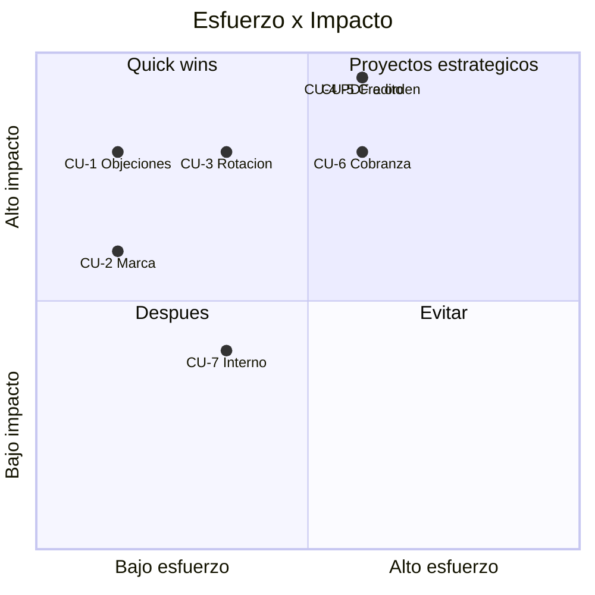

# Ruta 0 · Etapa 2 — Matriz Esfuerzo × Impacto y gestión del cambio

## 1. Puntuación (1 = bajo, 5 = alto; esfuerzo incluye datos, integración y cambio)
| ID | Caso de uso | Impacto | Esfuerzo | Cuadrante |
|---|---|---|---|---|
| CU-4 | Extracción PDF → orden de venta/expedición | 5 (≈ USD 1,35 M: fletes + boletos) | 3 | **Prioridad 1** |
| CU-5 | Pre-análisis de crédito con matriz de alzada | 5 (USD 1,25 M) | 3 | **Prioridad 1** |
| CU-1 | Asistente de objeciones y propuestas | 4 (pipeline USD 4,69 M) | 1 | **Quick win** |
| CU-2 | Gem de marca para contenidos | 3 | 1 | **Quick win** |
| CU-6 | Cobranza automática | 4 (USD 1,11 M) | 3 | Prioridad 2 |
| CU-3 | Rotación y sentimiento | 4 (rotación 22,8 %) | 2 | Quick win / prioridad 2 |
| CU-7 | Asistente interno | 2 | 2 | Más adelante |

## 2. Hoja de ruta
| Fase | Plazo | Contenido |
|---|---|---|
| 1 · Quick wins | 0–30 días | CU-1, CU-2, CU-3 (piloto con datos sintéticos/anonimizados) |
| 2 · Núcleo financiero | 30–90 días | CU-4 y CU-5 en paralelo a ERP legado (sin integración API), con revisión humana |
| 3 · Escala | 90–180 días | CU-6, panel SLA, evaluar reemplazo/integración del ERP |

## 3. Gestión del cambio
- **Patrocinio:** dirección general y financiera comunican "IA asiste, la persona decide".
- **Riesgo de resistencia:** equipos con burnout y miedo a ser reemplazados → mensaje: la IA elimina la digitación (20 salidas citan sobrecarga manual).
- **Capacitación:** talleres por área, guías de prompts, canal de dudas.
- **Campeones internos:** 1 por área (Ventas, Finanzas, RR. HH., Marketing).
- **Medición:** KPIs de la etapa 1 con revisión mensual; encuesta de adopción y eNPS.
- **Plan de salida:** si un piloto no cumple el KPI en 60 días, se pausa y se revisa.
