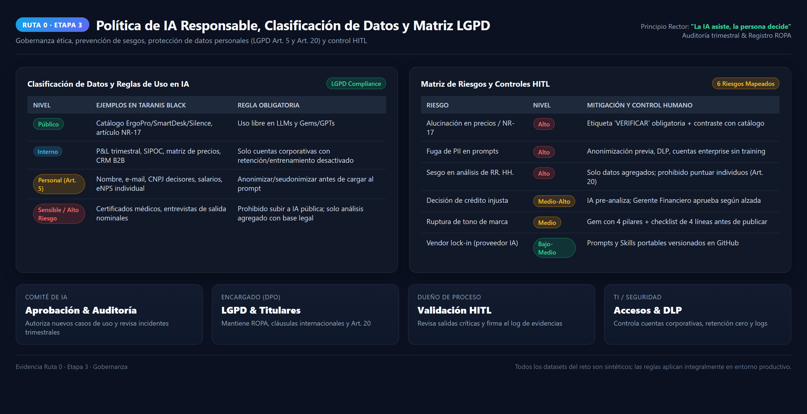

# Ruta 0 · Etapa 3 — Política de gobernanza, ética y LGPD

## 1. Principios
1. **Humano en el bucle:** decisiones con efecto sobre personas (crédito, contratación, desvinculación, evaluación) nunca son automáticas.
2. **Transparencia:** todo contenido generado con IA se identifica y se registra (prompt, versión, revisor).
3. **Minimización:** solo se comparten con la IA los datos necesarios.
4. **Equidad:** auditoría periódica de sesgos (género, edad, modelo de trabajo).
5. **Seguridad y trazabilidad:** versionado de prompts/Skills en este repositorio.
6. **Veracidad:** las afirmaciones técnicas (NR-17, ABERGO, garantías) se contrastan con el catálogo.

## 2. Clasificación de datos y reglas de uso
| Nivel | Ejemplos | Regla |
|---|---|---|
| Público | Catálogo, artículo de marca | Uso libre en herramientas de IA |
| Interno | P&L, SIPOC, precios | Solo cuentas corporativas con retención desactivada |
| Personal (LGPD art. 5) | Nombre, e-mail, CNPJ de decisores, salarios, eNPS individual | Anonimizar/seudonimizar antes de subirlo a IA |
| Sensible / alto riesgo | Salud (certificados médicos), motivos y entrevistas de salida | Solo agregados; no se sube a IA pública; base legal explícita |

## 3. LGPD — bases legales y derechos
- **Bases legales aplicables:** ejecución de contrato (clientes), interés legítimo (prospección B2B, con prueba de balance y opt-out), obligación legal (NR-17), consentimiento (datos sensibles/encuestas identificadas).
- **Derechos del titular:** acceso, corrección, anonimización, portabilidad, eliminación y revisión de decisiones automatizadas (art. 20) — canal con plazo de respuesta definido.
- **Encargado (DPO) y registro de operaciones (ROPA).**
- **Transferencia internacional:** evaluar si el proveedor de IA procesa fuera de Brasil y exigir cláusulas contractuales.
- **Incidentes:** notificación a la ANPD y titulares en plazo razonable.
- Los datos del kit son sintéticos; en producción se aplican todas las reglas.

## 4. Matriz de riesgos
| Riesgo | Prob. | Impacto | Mitigación |
|---|---|---|---|
| Alucinación en propuestas o claims NR-17 | Media | Alto | Revisión humana + fuente obligatoria del catálogo |
| Fuga de datos personales en prompts | Media | Alto | Anonimización, cuentas corporativas, DLP |
| Sesgo en análisis de RR. HH. | Media | Alto | Solo agregados; revisión por People Analytics |
| Decisión de crédito injusta | Baja | Alto | IA sugiere, gerente financiero aprueba |
| Incumplimiento de tono de marca | Media | Medio | Prompt con 4 pilares + checklist |
| Dependencia del proveedor de IA | Baja | Medio | Prompts portables, versionados |

## 5. Roles
| Rol | Responsabilidad |
|---|---|
| Comité de IA | Aprobar casos de uso, revisar incidentes |
| DPO | LGPD, derechos de titulares |
| Dueño de proceso | Validar salidas, firmar el log HITL |
| TI/Seguridad | Accesos, retención, DLP |

## 6. Controles y auditoría
Log HITL en [04_evidencias_hitl](../../04_evidencias_hitl/README.md) · revisión trimestral de sesgos · inventario de modelos y prompts · formación obligatoria.
