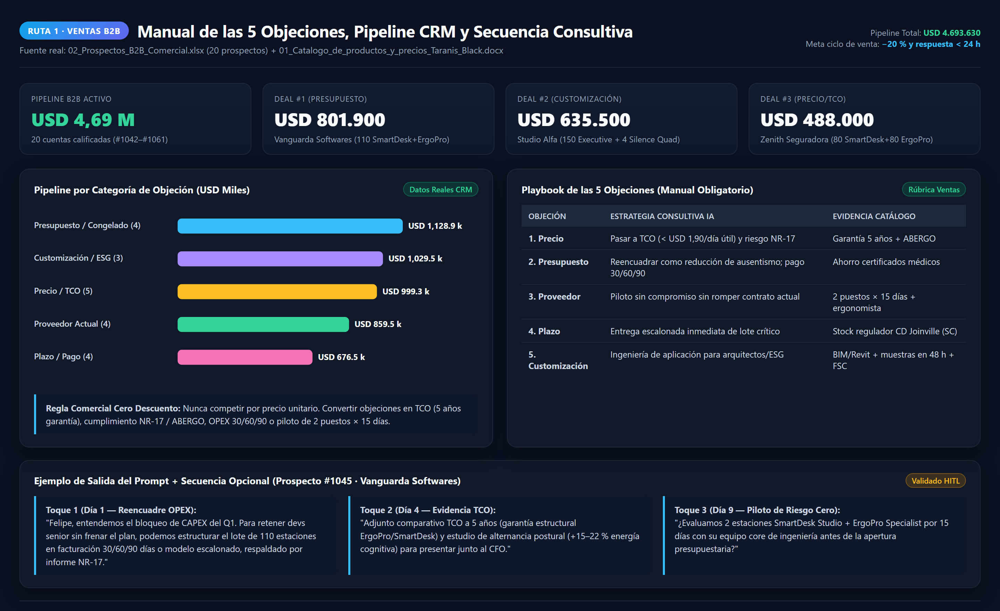
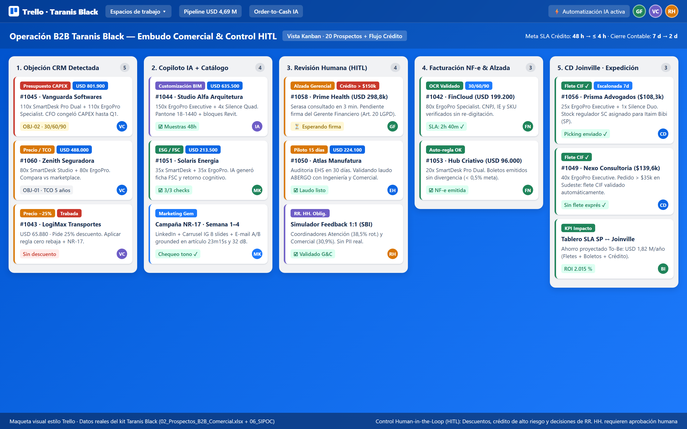

# Ruta 1 · Ventas y gestión comercial — Manual de 5 Objeciones y Secuencias

**Insumo:** `02_Prospectos_B2B_Comercial.xlsx` (20 prospectos, **USD 4.693.630** en pipeline) + `01_Catalogo_de_productos_y_precios_Taranis_Black.docx`.

### Vista operativa tipo Trello (Embudo B2B y control HITL)

## 1. Diagnóstico del pipeline CRM (20 prospectos reales)
| Categoría de objeción | N.º deals | Valor en pipeline (USD) | Cuentas representativas |
|---|---|---|---|
| **Presupuesto / Congelado** | 4 | **1.128.900** | `#1045 Vanguarda` ($801,9 k), `#1048 Rede Orion` ($113,4 k), `#1053 Hub Criativo` ($96 k), `#1057 Delta` ($117,6 k) |
| **Customización / ESG** | 3 | **1.029.500** | `#1044 Studio Alfa` ($635,5 k), `#1051 Solaris` ($213,5 k), `#1059 Aurora` ($180,5 k) |
| **Precio / TCO** | 5 | **999.330** | `#1060 Zenith` ($488 k), `#1052 Apex Capital` ($160,7 k), `#1047 InovaPay` ($143 k), `#1055 OmniVarejo` ($141,8 k), `#1043 LogiMax` ($65,9 k) |
| **Proveedor actual** | 4 | **859.450** | `#1058 Prime Health` ($298,8 k), `#1050 Atlas` ($224,1 k), `#1054 MetaData` ($182,5 k), `#1046 BioSaúde` ($154,1 k) |
| **Plazo de entrega / pago** | 4 | **676.450** | `#1061 NeoOffice` ($229,4 k), `#1042 FinCloud` ($199,2 k), `#1049 Nexo` ($139,6 k), `#1056 Prisma` ($108,3 k) |
| **Total Pipeline Activo** | **20** | **USD 4.693.630** | **Regla:** defender margen, cero descuentos no autorizados |

## 2. Manual de las 5 Objeciones (Entregable Obligatorio)
| ID | Objeción mapeada | Lo que NUNCA decir | Estrategia consultiva con IA | Evidencia oficial del catálogo |
|---|---|---|---|---|
| **OBJ-01** | **Precio:** *"El competidor es 30 % más barato"* | *"Nuestra calidad y diseño son más bonitos."* | Reencuadrar de precio unitario a **TCO a 5 años** (< USD 1,90/día útil vs vida útil de 14 meses en sillas genéricas) y protección frente a pasivos NR-17. | Garantía estructural de 5 años (`ErgoPro Executive/Specialist`), informe ABERGO y certificación ANSI/BIFMA X5.1. |
| **OBJ-02** | **Presupuesto:** *"CAPEX congelado por el CFO"* | *"Ok, hablamos el próximo año."* | Posicionar la ergonomía como **mitigación de riesgo operacional** (reducción de certificados médicos/ausentismo) y habilitar **facturación 30/60/90 días** o cuotas OPEX. | Facturación 30/60/90 días para CNPJ > 2 años tras aprobación de crédito; ahorro en ausentismo (`#1042` reporta +15 % bajas lumbares). |
| **OBJ-03** | **Proveedor actual:** *"Ya tenemos proveedor homologado"* | *"Nuestro producto es mucho más moderno."* | No pedir ruptura inmediata; proponer **proyecto piloto sin compromiso** en un área crítica (2 puestos × 15 días) para comparar satisfacción y laudo NR-17. | Piloto 2 puestos × 15 días + informe ergonómico individualizado firmado por Ingeniero y Ergonomista. |
| **OBJ-04** | **Plazo de entrega:** *"20–25 días es demasiado"* | *"La logística es complicada y fábrica está llena."* | Activar el stock regulador del **CD Santa Catarina (Joinville)** para **entrega escalonada** en 5–8 días hábiles del lote crítico (Sur/Sudeste), completando luego el resto. | Stock regulador CD Joinville; política CIF garantizada para pedidos > USD 35.000 en capitales Sur/Sudeste. |
| **OBJ-05** | **Customización:** *"¿Combina con nuestra arquitectura / ESG?"* | *"Solo vendemos el negro estándar del sitio."* | Activar Ingeniería de Aplicación: acabados FSC, tejidos mesh a medida (> 30 puestos, +5 días hábiles) y biblioteca gratuita **BIM / Revit / SketchUp** para arquitectos. | Muestras físicas en 48 h, madera ecológica certificada FSC y bloques 3D/BIM gratuitos. |

## 3. Flujo con Humano en el Bucle (HITL)
1. El CRM exporta la ficha del prospecto → la IA clasifica la objeción (`OBJ-01`..`OBJ-05`) y genera respuesta ≤ 150 palabras + 2 preguntas de descubrimiento.
2. El ejecutivo verifica precios contra catálogo (ej. *ErgoPro Executive* USD 3.490, *Specialist* USD 2.490, *Core* USD 1.890; *SmartDesk Pro Dual* USD 4.800, *Studio* USD 3.600; *Silence Quad* USD 28.000).
3. Condiciones especiales de pago (12× o carencia 60 días) requieren aprobación de Coordinación Comercial y Gerencia Financiera.
4. Se registra el envío y la validación en el CRM y en `04_evidencias_hitl`.

## 4. Secuencias de E-mail de Seguimiento (Entregable Opcional)
Ejemplo aplicado a **#1045 Vanguarda Softwares (USD 801.900 · VP de Gente & Gestión · Objeción CAPEX)**:
- **Toque 1 (Día 1 — Reencuadre OPEX y Retención Tech):** Respuesta consultiva conectando las 110 estaciones *SmartDesk Pro Dual + ErgoPro Specialist* con atracción de desarrolladores senior y facturación escalonada **30/60/90 días** para no trabar CAPEX de Q1.
- **Toque 2 (Día 4 — Caso TCO + ABERGO para el CFO):** Envío de hoja de cálculo de TCO a 5 años (garantía estructural de 5 años vs reposición cada 14 meses) + estudio de alternancia postural (+15–22 % energía cognitiva).
- **Toque 3 (Día 9 — Cierre con Piloto de Riesgo Cero):** Invitación a piloto de **2 estaciones por 15 días** en el equipo de ingeniería core antes de la reunión presupuestaria del comité.

## 5. KPIs de seguimiento
Tasa de respuesta a objeciones **< 24 h** · Conversión de propuestas enviadas · Reducción del ciclo de venta (**−20 %**) · Descuento medio otorgado (≤ 3 % bajo autorización).

**Prompt versionado:** [prompt_ventas_objeciones.md](../../03_prompts_y_skills/prompt_ventas_objeciones.md)
