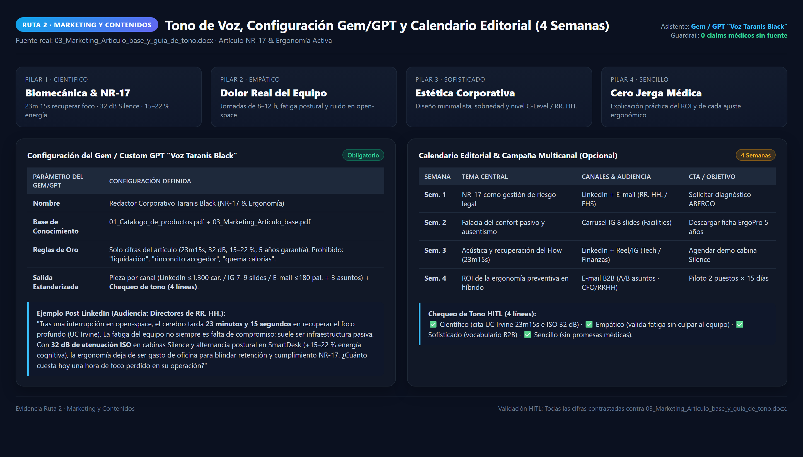

# Ruta 2 · Marketing y contenidos — Tono de Voz, Gem/GPT y Calendario

**Insumo:** `03_Marketing_Articulo_base_y_guia_de_tono.docx` (artículo técnico NR-17 + manual de identidad verbal) y `01_Catalogo_de_productos_y_precios_Taranis_Black.docx`.

## 1. Diagnóstico
Taranis Black cuenta con un artículo técnico sólido sobre ergonomía activa, ausentismo, acústica y NR-17, pero su equipo de Marketing (4 personas atendiendo B2B, D2C y redes, según `REG-009` de la encuesta de clima) opera "apagando incendios". El riesgo de usar IA genérica sin guía de marca es diluir el posicionamiento premium o introducir promesas médicas sin respaldo.

## 2. Los 4 Pilares de Tono de Voz (Entregable Obligatorio)
| Pilar | Cómo hablamos (SÍ) | Cómo NUNCA hablamos (NO) |
|---|---|---|
| **1. Científico y fundamentado** | Biomecánica, informes NR-17/ABERGO, atenuación ISO 23351-1 y estudios citados en el artículo. | Adjetivos vacíos (*"la mejor del mercado"*, *"súper cómoda"*). |
| **2. Empático y humano** | Reconocemos fatiga lumbar/cervical y ruido en *open-space* con respeto al equipo. | Tono punitivo o frases cursis (*"rinconcito lindo y acogedor"*). |
| **3. Sofisticado y premium** | Sobriedad estética, nivel C-Level / RR. HH. / Facilities y arquitectura corporativa. | Lenguaje de liquidación (*"¡Aproveche oferta relámpago!"*). |
| **4. Sencillo y accesible** | Explicamos el ROI de cada ajuste lumbar, motor o cabina de forma clara. | Jerga médica hermética ni promesas clínicas (*"cura lesiones"* / *"quema calorías"*). |

### Cifras autorizadas (únicas permitidas del artículo base)
- **23 minutos 15 segundos** para recuperar el foco tras una interrupción en *open-space* (UC Irvine).
- **32 dB** de atenuación sonora certificada ISO 23351-1 (*Silence Quad/Duo*; 30 dB en *Silence Solo*).
- **15–22 %** más de energía cognitiva con alternancia postural (*Sit-Stand* en *SmartDesk*).
- **5 años** de garantía estructural (*ErgoPro Executive/Specialist* y estructura *SmartDesk*).
- Cumplimiento normativo **NR-17** e informes **ABERGO**.

## 3. Especificación lista del Gem / Custom GPT "Voz Taranis Black" (Obligatorio)
- **Nombre:** `Redactor Corporativo Taranis Black (NR-17)`
- **Archivos de conocimiento (Knowledge):** `03_Marketing_Articulo_base_y_guia_de_tono.pdf` + `01_Catalogo_de_productos_y_precios_Taranis_Black.pdf`.
- **Variables de entrada:** `articulo_base`, `audiencia` (RR. HH., Facilities, Arquitectos o CFO), `canal` (LinkedIn / Instagram / E-mail).
- **System Instructions:** Ver prompt completo y versionado en [prompt_marketing_voz_marca.md](../../03_prompts_y_skills/prompt_marketing_voz_marca.md).
- **Regla de salida:** Entregar siempre la pieza ajustada al canal + un **"Chequeo de tono" de 4 líneas** verificando cada pilar y las cifras citadas.

## 4. Calendario Editorial y Campaña Multicanal — 4 Semanas (Entregable Opcional)
| Semana | Tema central | Canal y audiencia | CTA / Entregable |
|---|---|---|---|
| **1** | NR-17 como gestión de riesgo legal y pasivos laborales | Post LinkedIn + E-mail (RR. HH. / EHS) | Solicitar diagnóstico ergonómico ABERGO |
| **2** | La falacia del "confort pasivo" frente a la ergonomía activa | Carrusel Instagram 8 slides (Facilities / Compras) | Comparar TCO 5 años (*ErgoPro*) |
| **3** | Acústica en *open-space* y recuperación del *Flow* (23m 15s) | Post LinkedIn + Reels (Tech / Finanzas) | Agendar demo cabina *Silence* (32 dB) |
| **4** | ROI preventivo de mesas elevables en modelos híbridos 3×2 | E-mail B2B con test A/B de 3 asuntos (CFO / Gente) | Activar piloto 2 puestos × 15 días |

### Muestra validada (Post LinkedIn · Audiencia RR. HH.)
> Tras una interrupción en oficina abierta, el cerebro tarda **23 minutos y 15 segundos** en recuperar el foco profundo (UC Irvine). La caída de energía a mitad de la tarde rara vez es falta de compromiso: es infraestructura pasiva. Combinar cabinas acústicas con **32 dB de atenuación ISO** y alternancia postural en escritorios *SmartDesk* (+15–22 % de energía cognitiva) convierte la ergonomía en una palanca medible de retención y cumplimiento **NR-17**. ¿Su equipo de Facilities y RR. HH. ya cuantificó cuántas horas de foco se pierden por semana en su sede?

## 5. Checklist de validación humana (HITL)
☐ Cumple los 4 pilares de tono · ☐ Todas las cifras son trazables al artículo base · ☐ Cero promesas médicas o urgencia promocional · ☐ CTA claro para el canal · ☐ Aprobación de Marca/Legal antes de publicar.

**Prompt versionado:** [prompt_marketing_voz_marca.md](../../03_prompts_y_skills/prompt_marketing_voz_marca.md)
