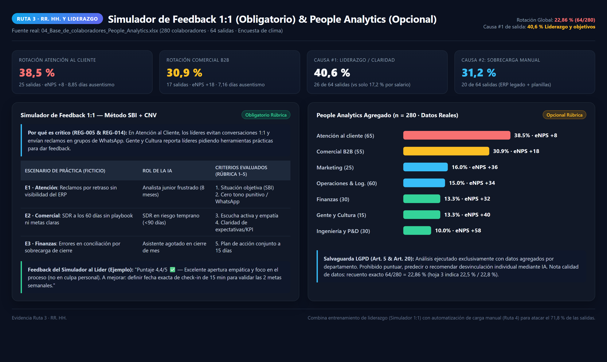

# Ruta 3 · RR. HH. — Simulador de Feedback 1:1 (Obligatorio) y People Analytics (Opcional)

**Insumo:** `04_Base_de_colaboradores_People_Analytics.xlsx` (280 colaboradores, encuesta de clima de 14 registros e indicadores por departamento).

## 1. Diagnóstico y justificación (por qué el Simulador de Feedback es el núcleo obligatorio)
De las **64 desvinculaciones** del último año (**22,86 %** sobre 280 colaboradores), los dos motivos dominantes son de gestión y procesos, no salariales:
1. **40,6 % (26 salidas):** *"Falta de claridad en los objetivos y comunicación difícil con el liderazgo directo"*.
2. **31,2 % (20 salidas):** *"Sobrecarga con tareas manuales y sistemas lentos"*.
3. **17,2 % (11 salidas):** *"Propuesta salarial competidor"* · **10,9 % (7 salidas):** *"Otros"*.

Además, la encuesta de clima revela dos alertas directas sobre liderazgo:
- **`REG-005` (Atención al cliente, 38,5 % rotación):** *"El liderazgo tiene miedo de llamar a los colaboradores para conversar de forma individual. Cuando hay problema, mandan bronca colectiva en el grupo de WhatsApp."*
- **`REG-014` (Gente y Cultura):** *"Los administradores del equipo nos buscan desesperados pidiendo ayuda para dar retroalimentación, pero no tenemos herramientas prácticas para empoderarlos."*

## 2. Simulador de Feedback 1:1 con IA — Modelo SBI + CNV (Entregable Obligatorio)
Herramienta interactiva de entrenamiento (*roleplay*) para coordinadores de **Atención al cliente** y **Comercial B2B** antes de sostener conversaciones reales 1:1.

### 2.1 Estructura del simulador (Prompt en `03_prompts_y_skills/prompt_rrhh_simulador_feedback.md`)
- **Rol de la IA:** Actúa en dos fases: primero interpreta a un colaborador ficticio en un escenario realista del clima de Taranis Black (el líder practica su conversación en 3–5 turnos); al cerrar, la IA cambia a rol de **Coach de Gente y Cultura** y entrega una evaluación estructurada.
- **Metodología entrenada:** **SBI** (*Situación — Comportamiento observado — Impacto*) + **CNV** (*Comunicación No Violenta*) + acuerdo de objetivos claros a 15 días.

### 2.2 Escenarios de práctica (ficticios, alineados al clima real)
| Escenario | Área objetivo | Perfil simulado | Objetivo de aprendizaje del líder |
|---|---|---|---|
| **E1 · Atención al cliente** | Atención (38,5 % rotación, eNPS +8) | Analista frustrado por llamadas de clientes sin trazabilidad del ERP; temor a reprimenda en WhatsApp. | Sustituir reclamo grupal por 1:1 privado, validar frustración operativa y acordar protocolo de escalamiento. |
| **E2 · Comercial B2B** | Ventas (30,9 % rotación, 29,4 % < 90 d) | SDR con 60 días que siente falta de playbook y presión diaria sin feedback constructivo (`REG-001` / `REG-003`). | Aterrizar 2 metas semanales medibles, revisar objeciones con apoyo del asistente de Ruta 1 y fijar *check-in*. |
| **E3 · Finanzas / Operaciones** | Finanzas (cierre 7 días) | Asistente con *burnout* tras horas extras en conciliación entre 3 Excels (`REG-007`). | Reconocer esfuerzo, priorizar errores críticos con enfoque de proceso (no culpa) y liberar carga con Ruta 4. |

### 2.3 Rúbrica de evaluación automática del Simulador (1 a 5 puntos por criterio)
1. **Apertura segura y privada:** Evita tono punitivo o acusatorio; abre con contexto claro y respeto.
2. **Evidencia objetiva (SBI):** Describe hechos concretos y su impacto en el cliente/equipo, sin etiquetas personales.
3. **Escucha activa y empatía:** Hace preguntas abiertas para entender bloqueos de herramientas u onboarding.
4. **Claridad de expectativas:** Define 1–2 objetivos concretos, medibles y alcanzables para los próximos 15 días.
5. **Compromiso de seguimiento:** Agenda fecha de revisión 1:1 (eliminando la gestión reactiva por WhatsApp).

## 3. People Analytics Agregado — Datos Reales (Entregable Opcional)
| Departamento | Plantilla | Salidas | Rotación real | eNPS | Ausentismo medio (días/año) | Salario medio (USD) |
|---|---|---|---|---|---|---|
| **Atención al cliente** | 65 | 25 | **38,5 %** | **+8** | **8,85** | 4.464 |
| **Comercial B2B** | 55 | 17 | **30,9 %** | **+18** | **7,16** | 7.541 |
| Marketing | 25 | 4 | 16,0 % | +36 | 6,20 | 6.351 |
| Operaciones y Logística | 60 | 9 | 15,0 % | +34 | 6,32 | 4.522 |
| Finanzas | 30 | 4 | 13,3 % | +32 | 5,73 | 6.791 |
| Gente y Cultura | 15 | 2 | 13,3 % | +40 | 6,33 | 7.098 |
| Ingeniería y P&D | 30 | 3 | 10,0 % | +58 | 5,10 | 8.900 |
| **Total Taranis Black** | **280** | **64** | **22,86 %** | **+28** | **6,70** *(pond.)* | — |

- **Hallazgo clave:** Atención al cliente tiene el menor salario medio (USD 4.464), pero también el eNPS más bajo (+8) y el mayor ausentismo (8,85 días). En Comercial B2B el salario medio es alto (USD 7.541) y aun así la rotación llega al 30,9 %: esto confirma que **el problema principal es liderazgo y procesos, no solo compensación**.
- **Nota de calidad de datos (HITL):** El archivo guía menciona 22,5 % general y 24 % antes de 90 días (hoja 3 indica 22,8 % y 23,4 %). El recuento fila por fila sobre los 280 colaboradores arroja **64/280 = 22,86 %** y **13/64 = 20,3 %** salidas con ≤ 90 días (`Días hasta Desconectado ≤ 90`). Se documenta para trazabilidad antes de presentar al Comité.

## 4. Salvaguardas éticas y LGPD
- **Prohibición estricta (LGPD art. 20):** La IA **no** califica ni predice el riesgo de salida de colaboradores individuales ni decide desvinculaciones.
- Tanto el Simulador de Feedback (escenarios ficticios) como People Analytics (cifras agregadas por área) operan sin nombres reales ni salarios individuales en prompts externos.
- Revisión trimestral de sesgos (género, antigüedad, modelo híbrido vs remoto) por Gente y Cultura + DPO.

## 5. KPIs objetivo
- Adopción del Simulador 1:1 por 100 % de coordinadores en 30 días · Rotación en Atención y Comercial **−30 %** · eNPS global **+10 puntos** · Rotación primeros 90 días **< 15 %** · Ausentismo **−15 %**.

**Prompts versionados:**
- [prompt_rrhh_simulador_feedback.md](../../03_prompts_y_skills/prompt_rrhh_simulador_feedback.md) *(Obligatorio)*
- [prompt_rrhh_people_analytics.md](../../03_prompts_y_skills/prompt_rrhh_people_analytics.md) *(Opcional)*
