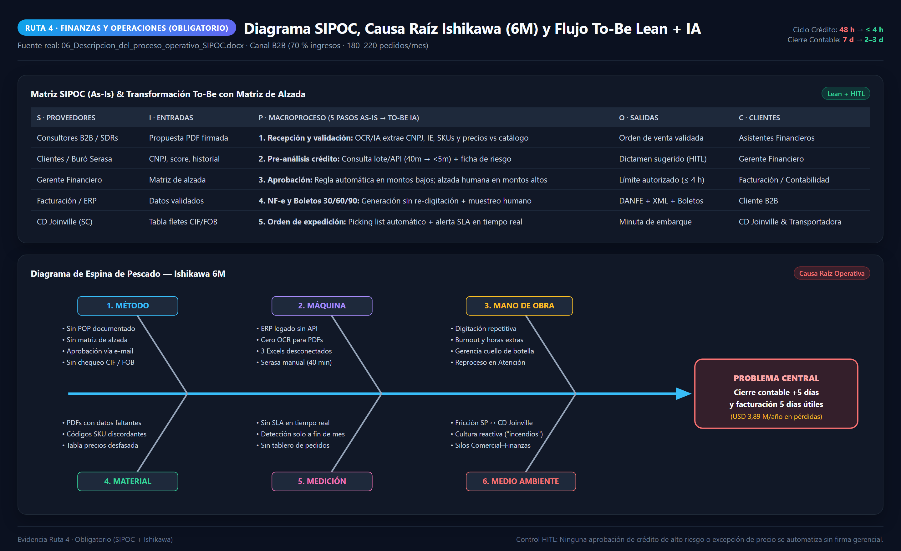
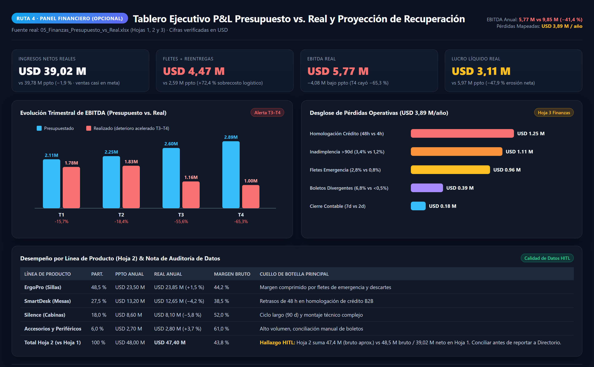
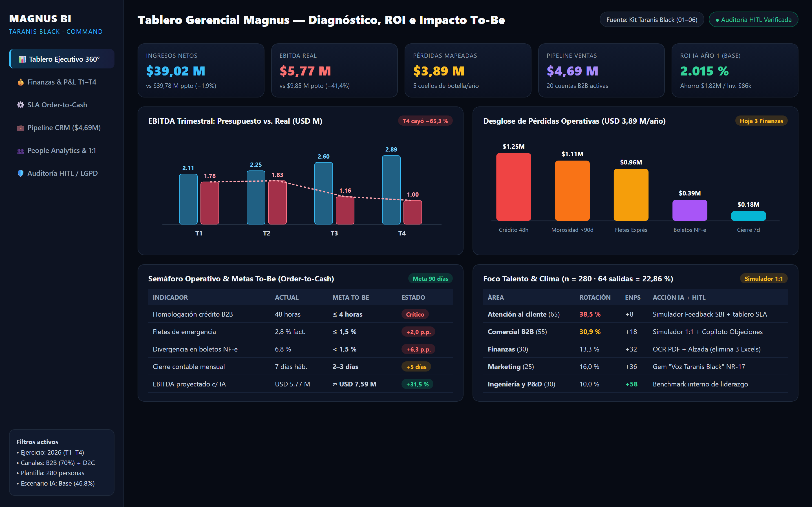
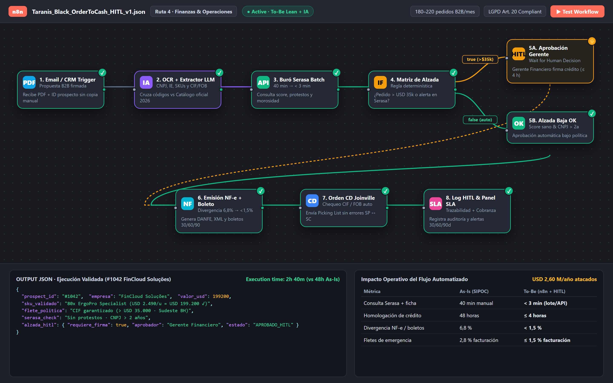

# Ruta 4 · Finanzas y operaciones — SIPOC, Ishikawa (Obligatorio) y Panel Financiero (Opcional)

**Insumo:** `05_Finanzas_Presupuesto_vs_Real.xlsx` + `06_Descripcion_del_proceso_operativo_SIPOC.docx`.

## 1. Diagnóstico financiero — Panel P&L Presupuesto vs. Real (Entregable Opcional)

### Tablero Gerencial estilo Magnus BI (360°)

| Concepto P&L (USD) | Presupuesto anual | Real anual | Variación | Lectura ejecutiva |
|---|---|---|---|---|
| Ingresos brutos | 48.600.000 | 48.500.000 | −0,2 % | La demanda comercial casi cumplió la meta |
| Cancelaciones por retraso logístico | −560.000 | **−1.235.000** | **+120,5 %** | Se duplicaron las cancelaciones por demora |
| **Ingresos operativos netos** | **39.778.000** | **39.020.000** | **−1,9 %** | — |
| **Lucro bruto operacional** | **19.698.000** | **18.430.000** | **−6,4 %** | Erosión de margen bruto por retrasos |
| Fletes y logística de entrega CD | −2.380.000 | **−3.740.000** | **+57,1 %** | Fletes exprés de emergencia desde Joinville |
| Reentregas y multas por divergencia | −210.000 | **−725.000** | **+245,2 %** | Errores manuales al transcribir pedidos |
| Provisión incobrables (PDD > 90 d) | −440.000 | **−1.110.000** | **+152,3 %** | Cobranza manual tardía |
| **EBITDA** | **9.848.000** | **5.770.000** | **−41,4 %** | Deterioro severo: T1 −15,7 % → **T4 −65,3 %** |
| **Lucro líquido** | **5.965.080** | **3.108.600** | **−47,9 %** | Casi la mitad de la utilidad presupuestada perdida |

### Hallazgo de calidad de datos (HITL)
La hoja 2 (`Ingresos_por_producto`) reporta ingresos reales de **USD 47,40 M** (`ErgoPro` 23,85 M · `SmartDesk` 12,65 M · `Silence` 8,10 M · `Accesorios` 2,80 M) frente a **USD 48,50 M** brutos y **USD 39,02 M** netos en la hoja 1. Se marca explícitamente para conciliación contable antes de presentar cifras definitivas al Directorio.

## 2. Matriz SIPOC del proceso As-Is (Entregable Obligatorio)
*Canal B2B corporativo = 70 % de los ingresos (USD 33,6 M reales; 180–220 pedidos/mes).*

| S · Proveedores | I · Entradas | P · Macroproceso (5 pasos As-Is) | O · Salidas | C · Clientes |
|---|---|---|---|---|
| Consultores B2B y SDRs | Propuesta comercial firmada en PDF | **1.** Recepción y selección de propuestas en correo | Orden de venta registrada | Asistentes financieros |
| Clientes B2B | Datos catastrales (CNPJ, IE, dirección) | **2.** Consulta manual a Serasa (40 min/pedido) + 3 Excels | Ficha y dictamen de crédito | Gerente financiero |
| Buró Serasa Experian | Score financiero, protestas y deudas | **3.** Solicitud y espera de aprobación por e-mail (hasta 48 h) | Autorización formal a plazo | Facturación / Contabilidad |
| Gerente financiero | Aprobación por correo | **4.** Re-digitación manual de NF-e y boletos 30/60/90 | DANFE, XML NF-e y boletos | Cliente comprador |
| CD Joinville (SC) y transportadoras | Tabla de fletes CIF/FOB y rutas | **5.** Envío por e-mail manual de orden de expedición | *Picking list* y minuta | Equipo CD Joinville |

## 3. Diagrama de Ishikawa (6M) (Entregable Obligatorio)
**Problema central:** *Atraso de 5 días en el cierre contable mensual (7 vs 2 días hábiles) y ciclo de facturación de 5 días útiles.*

- **Método:** Ausencia de POP estandarizado; flujo dependiente de e-mails informales; sin matriz de alzada automática (toda solicitud va a gerencia); sin validación previa CIF/FOB.
- **Máquina:** ERP legado sin API; cero OCR/IA para leer propuestas PDF; 3 hojas Excel locales sin sincronización; consulta manual a Serasa (40 min).
- **Mano de obra:** Equipo financiero en *burnout* por copiado mecánico de datos; cuello de botella gerencial por centralización de aprobaciones; reprocesos en Atención al cliente (`REG-006`).
- **Material:** Propuestas con campos incompletos; códigos de producto en PDF discordantes con el ERP; tabla de precios comercial desfasada.
- **Medición:** Inexistencia de tablero de SLA por etapa; los atrasos se detectan recién al cierre de mes; falta de visibilidad para Atención al cliente (`REG-004`).
- **Medio ambiente:** Fricción y distancia física entre Comercial (São Paulo) y el CD (Joinville/SC); cultura reactiva de "apagar incendios".

## 4. Proceso To-Be Lean + IA con Matriz de Alzada y HITL

| Paso | Transformación Lean + IA | Control HITL | Impacto esperado |
|---|---|---|---|
| **1** | **OCR + LLM** extrae CNPJ, IE, SKUs, dirección y flete CIF/FOB del PDF y valida contra el catálogo oficial. | Alerta automática ante cualquier campo faltante o SKU divergente. | Cero re-digitación manual |
| **2** | Consulta automática por lote/API a Serasa + ficha resumida de riesgo generada por IA. | Prohibido que la IA apruebe crédito por sí sola. | 40 min → **< 5 min** |
| **3** | **Matriz de alzada:** pedidos bajo umbral y score sano avanzan bajo regla determinística; montos altos o alertas pasan al Gerente Financiero con ficha lista. | **Aprobación humana obligatoria** para excepciones y montos altos. | 48 h → **≤ 4 h** |
| **4** | Emisión de NF-e/boletos 30/60/90 desde el dato validado + muestreo diario de auditoría. | Revisión humana por muestreo y conciliación automatizada. | Divergencia 6,8 % → **< 1,5 %** |
| **5** | Orden de expedición enviada al CD Joinville con chequeo CIF/FOB automático (> USD 35 k Sur/Sudeste). | Confirmación logística en tablero compartido SP–Joinville. | Fletes emergencia 2,8 % → **≤ 1,5 %** |
| **6** | **Panel SLA en tiempo real + alertas tempranas de cobranza** (recordatorios previos al vencimiento). | Escalamiento humano para cuentas > 30 días en mora. | Cierre 7 d → **2–3 d** |

## 5. Valor económico estimado (hipótesis de captura sobre USD 3,89 M)
| Palanca | Costo actual (USD) | Captura base supuesta | Ahorro anual estimado (USD) |
|---|---|---|---|
| Crédito rápido (48 h → ≤ 4 h) | 1.250.000 | 50 % | 625.000 |
| Fletes de emergencia y reentregas | 960.000 | 50 % | 480.000 |
| Inadimplencia B2B > 90 días | 1.110.000 | 30 % | 333.000 |
| Boletos/NF-e divergentes | 390.000 | 70 % | 273.000 |
| Cierre contable tardío | 180.000 | 60 % | 108.000 |
| **Total ahorro base estimado** | **3.890.000** | **46,8 %** | **USD 1.819.000 / año** |

*Escenario conservador: USD 1.095.000 (ROI 1.173 %) · Escenario optimista: USD 2.450.500 (ROI 2.749 %) sobre inversión Año 1 estimada en USD 86.000.*

**Prompt versionado:** [prompt_finanzas_operaciones.md](../../03_prompts_y_skills/prompt_finanzas_operaciones.md)
