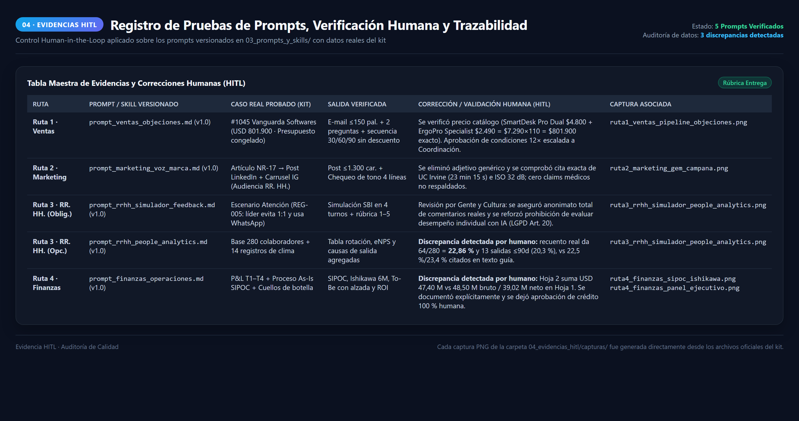
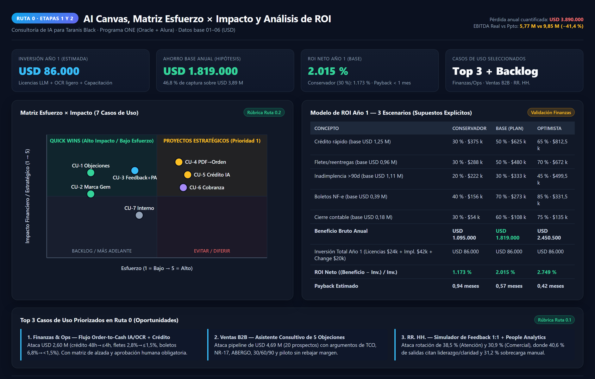
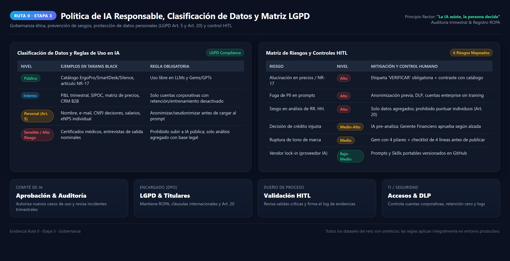
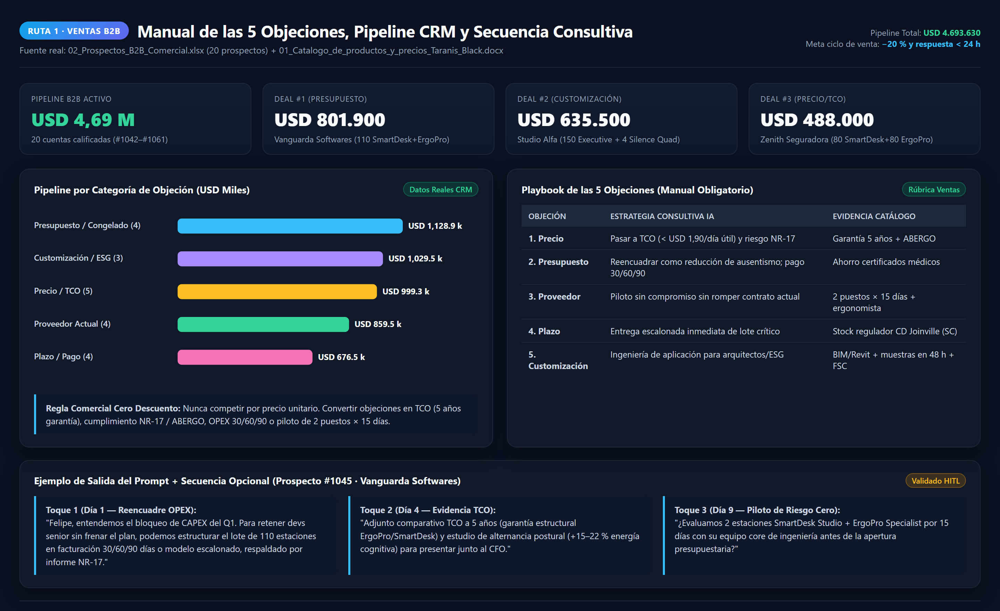
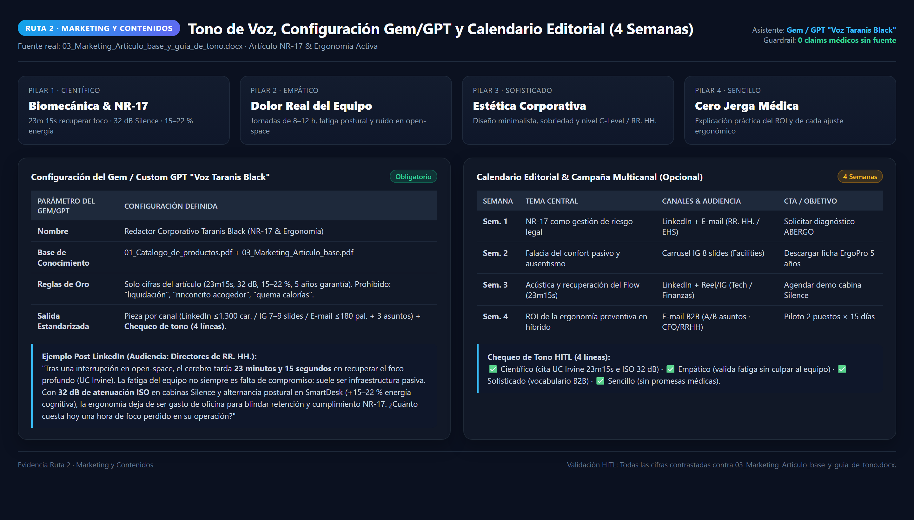
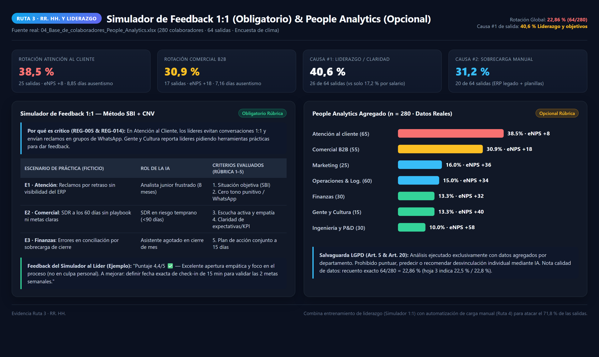
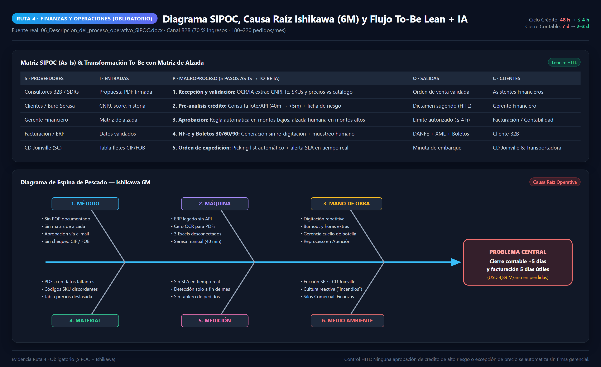
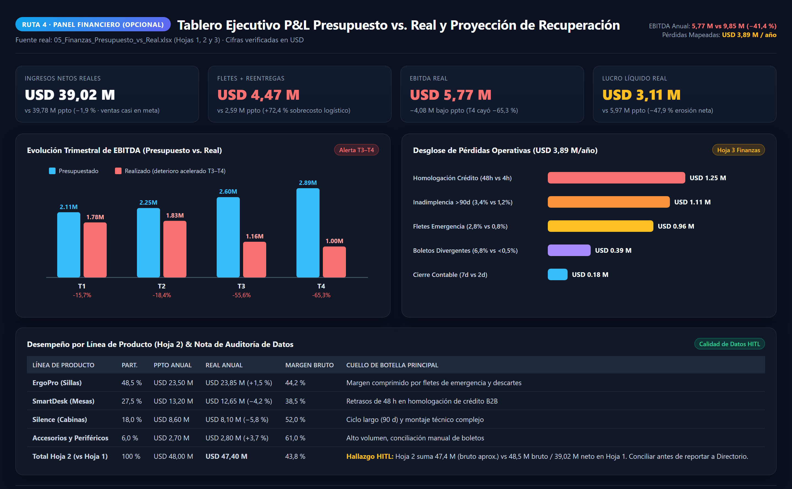

# 04_evidencias_hitl — Tabla de Evidencias y Capturas (Pantallazos)

Registro oficial de validación **Human-in-the-Loop (HITL)**, capturas analíticas generadas directamente desde los archivos del kit (`00_kit_datos_originales/archivos/`) y trazabilidad de pruebas sobre los prompts versionados en [`03_prompts_y_skills`](../03_prompts_y_skills/README.md).

## 1. Tabla de evidencias y capturas (Rúbrica · Entrega)

| Fecha | Ruta / Etapa | Prompt o Recurso | Caso / Dataset Verificado | Salida revisada | Corrección / Validación Humana (HITL) | Revisor | Captura (Pantallazo) |
|---|---|---|---|---|---|---|---|
| 2026-11-18 | **Ruta 0 · Etapas 1 y 2** | AI Canvas + Matriz + ROI | `05_Finanzas` + `02_Prospectos` + `04_RRHH` | Top 3 casos de uso, Matriz Esfuerzo×Impacto y ROI Año 1 (Base 2.015 % / Conservador 1.173 %) | Se validó que los porcentajes de captura (30–70 %) e inversión (USD 86 k) queden etiquetados explícitamente como supuestos sujetos a aprobación financiera. | Consultor IA / Finanzas | [ruta0_matriz_esfuerzo_impacto_roi.png](./capturas/ruta0_matriz_esfuerzo_impacto_roi.png) |
| 2026-11-18 | **Ruta 0 · Etapa 3** | Política LGPD y Gobernanza | Matriz de riesgos + Art. 5 y Art. 20 LGPD | 4 niveles de datos, 6 riesgos mitigados y roles | Se estableció prohibición estricta de subir datos nominales/salarios a IA pública y obligatoriedad de firma humana en crédito y RR. HH. | DPO / Comité IA | [ruta0_gobernanza_lgpd.png](./capturas/ruta0_gobernanza_lgpd.png) |
| 2026-11-18 | **Ruta 1 · Ventas** | `prompt_ventas_objeciones.md` (v1.0) | 20 prospectos CRM (USD 4.693.630) · Caso `#1045 Vanguarda Softwares` | Manual de 5 objeciones + secuencia de 3 e-mails (OPEX 30/60/90, TCO, piloto) | Se contrastó precio exacto en catálogo (`SmartDesk Pro Dual` $4.800 + `ErgoPro Specialist` $2.490 = $7.290 × 110 = $801.900). Condiciones 12× escaladas a Coordinación. | Coordinador Comercial | [ruta1_ventas_pipeline_objeciones.png](./capturas/ruta1_ventas_pipeline_objeciones.png) |
| 2026-11-18 | **Ruta 2 · Marketing** | `prompt_marketing_voz_marca.md` (v1.0) | `03_Marketing_Articulo_base_y_guia_de_tono.docx` | Config Gem/GPT + Calendario 4 sem. + Post LinkedIn + Chequeo de tono | Se eliminaron adjetivos genéricos y se verificó cita exacta de UC Irvine (23 min 15 s) e ISO 32 dB; cero claims médicos sin fuente. | Marca / Legal | [ruta2_marketing_gem_campana.png](./capturas/ruta2_marketing_gem_campana.png) |
| 2026-11-18 | **Ruta 3 · RR. HH. (Oblig.)** | `prompt_rrhh_simulador_feedback.md` (v1.0) | Escenarios anónimos `REG-005` (Atención) y `REG-001` (Comercial) | Simulación 1:1 (SBI + CNV) + rúbrica 1–5 | Gente y Cultura validó uso 100 % formativo con personajes ficticios; cero evaluación individual real (LGPD art. 20). | Gente y Cultura | [ruta3_rrhh_simulador_people_analytics.png](./capturas/ruta3_rrhh_simulador_people_analytics.png) |
| 2026-11-18 | **Ruta 3 · RR. HH. (Opc.)** | `prompt_rrhh_people_analytics.md` (v1.0) | `04_Base_de_colaboradores_People_Analytics.xlsx` (280 filas) | Rotación por área, eNPS, ausentismo y motivos de salida | **Discrepancia detectada por humano:** recuento real da 64/280 = **22,86 %** y 13 salidas ≤ 90 d (**20,3 %**), vs 22,5 % / 23,4 % indicados en guía. | People Analytics | [ruta3_rrhh_simulador_people_analytics.png](./capturas/ruta3_rrhh_simulador_people_analytics.png) |
| 2026-11-18 | **Ruta 4 · Finanzas (Oblig.)** | `prompt_finanzas_operaciones.md` (v1.0) | `06_Descripcion_del_proceso_operativo_SIPOC.docx` | Matriz SIPOC + Ishikawa 6M + Flujo To-Be con matriz de alzada | Se aseguró que toda aprobación de crédito de alto monto/excepción mantenga firma del Gerente Financiero. | Gerente Financiero | [ruta4_finanzas_sipoc_ishikawa.png](./capturas/ruta4_finanzas_sipoc_ishikawa.png) |
| 2026-11-18 | **Ruta 4 · Finanzas (Opc.)** | `prompt_finanzas_operaciones.md` (v1.0) | `05_Finanzas_Presupuesto_vs_Real.xlsx` (Hojas 1, 2 y 3) | Panel P&L T1–T4 (EBITDA −41,4 %) + cascada USD 3,89 M | **Discrepancia detectada por humano:** Hoja 2 suma **USD 47,40 M** vs **48,50 M** bruto / **39,02 M** neto en Hoja 1. Documentado para conciliación contable. | Contraloría / Finanzas | [ruta4_finanzas_panel_ejecutivo.png](./capturas/ruta4_finanzas_panel_ejecutivo.png) |

---

## 2. Galería visual de capturas incluidas en el repositorio

### Ruta 0 · Base estratégica (AI Canvas, Matriz, ROI y Gobernanza LGPD)

### Ruta 1 · Ventas B2B (Manual 5 objeciones, Pipeline USD 4,69 M y Secuencias)

### Ruta 2 · Marketing (4 Pilares, Gem/GPT y Calendario 4 semanas)

### Ruta 3 · RR. HH. (Simulador de Feedback 1:1 y People Analytics)

### Ruta 4 · Finanzas y Operaciones (SIPOC, Ishikawa 6M y Panel Financiero T1–T4)

---

## 3. Enlaces externos opcionales (si deseas adjuntar sesiones web de ChatGPT/Gemini)
Si además ejecutas alguno de los prompts en tu cuenta personal de ChatGPT, Gemini Gem o Claude y quieres anexar el enlace público de la conversación en el Google Docs, pégalo en esta tabla antes de entregar:

| Ruta | Enlace público de chat / Gem / Artifact (opcional) | Probado en incógnito |
|---|---|---|
| Ruta 1 · Ventas | _Opcional: pegar URL compartida_ | ☐ |
| Ruta 2 · Marketing | _Opcional: pegar URL del Gem/GPT_ | ☐ |
| Ruta 3 · RR. HH. | _Opcional: pegar URL del Simulador_ | ☐ |
| Ruta 4 · Finanzas | _Opcional: pegar URL del Live Artifact_ | ☐ |

Ver también [checklist_entrega.md](./checklist_entrega.md).
