# Reto Taranis Black — ONE AI for Business (AI Builder)

> Consultoría estratégica de Inteligencia Artificial aplicada a **Taranis Black** para el programa **Oracle Next Education (ONE)** + **Alura**. Incluye diagnóstico de datos reales del kit, **Ruta 0** (AI Canvas + 3 casos de uso, Matriz Esfuerzo × Impacto + **ROI**, Gobernanza LGPD), desarrollo integral de las **4 áreas de especialización** (con foco principal recomendado en **Finanzas y Operaciones**), prompts versionados, **evidencias Human-in-the-Loop (HITL)** con **pantallazos analíticos**, e **Informe Ejecutivo listo para Google Docs**.

---

## Resumen ejecutivo

Taranis Black cerró el ejercicio con ingresos netos de **USD 39,02 M** (vs USD 39,78 M presupuestados, −1,9 %), pero su **EBITDA cayó −41,4 %** (**USD 5,77 M reales vs USD 9,85 M presupuestados**), con un desplome del −65,3 % en el cuarto trimestre. El kit operativo cuantifica **USD 3.890.000/año** en pérdidas por homologación manual de crédito (48 h), inadimplencia > 90 días (3,4 %), fletes de emergencia (2,8 %), boletos/NF-e divergentes (6,8 %) y cierre contable tardío (7 días), además de una rotación del **22,86 %** (64 salidas de 280 colaboradores: **38,5 %** en Atención al cliente y **30,9 %** en Comercial B2B).

La solución propuesta combina automatización ligera con **supervisión humana obligatoria (HITL)** y cumplimiento **LGPD**, proyectando un ahorro base estimado de **USD 1.819.000/año** (**ROI Año 1 de 2.015 %** sobre inversión estimada de USD 86.000; escenario conservador: **1.173 %**).

---

## Cumplimiento de la Rúbrica — Mapa del Challenge

| Bloque de la rúbrica | Requisito (Obligatorio / Opcional) | Estado | Documento y evidencia |
|---|---|---|---|
| **Ruta 0 · 1. Oportunidades** | **Obligatorio:** AI Canvas y 3 casos de uso | ✅ | [ai_canvas.md](./01_ruta_0_base_estrategica/etapa_1_ai_canvas/ai_canvas.md) |
| **Ruta 0 · 2. Prioridad y cambio** | **Obligatorio:** Matriz esfuerzo × impacto **y ROI** | ✅ | [matriz_esfuerzo_impacto.md](./01_ruta_0_base_estrategica/etapa_2_matriz_impacto/matriz_esfuerzo_impacto.md) · [Pantallazo](./04_evidencias_hitl/capturas/ruta0_matriz_esfuerzo_impacto_roi.png) |
| **Ruta 0 · 3. IA responsable** | **Obligatorio:** Política, riesgos y gobernanza (LGPD) | ✅ | [politica_gobernanza_etica_lgpd.md](./01_ruta_0_base_estrategica/etapa_3_gobernanza_lgpd/politica_gobernanza_etica_lgpd.md) · [Pantallazo](./04_evidencias_hitl/capturas/ruta0_gobernanza_lgpd.png) |
| **Especialización · Ventas** | **Oblig.:** Manual 5 objeciones · **Opc.:** Secuencias de email | ✅ | [ruta_1_ventas.md](./02_vertical_especializacion/etapa_1_obligatoria/ruta_1_ventas.md) · [Pantallazo](./04_evidencias_hitl/capturas/ruta1_ventas_pipeline_objeciones.png) |
| **Especialización · Marketing** | **Oblig.:** Tono de voz + Gem/GPT · **Opc.:** Calendario y campaña | ✅ | [ruta_2_marketing.md](./02_vertical_especializacion/etapa_1_obligatoria/ruta_2_marketing.md) · [Pantallazo](./04_evidencias_hitl/capturas/ruta2_marketing_gem_campana.png) |
| **Especialización · RR. HH.** | **Oblig.:** Simulador de feedback · **Opc.:** People Analytics | ✅ | [ruta_3_rrhh.md](./02_vertical_especializacion/etapa_1_obligatoria/ruta_3_rrhh.md) · [Prompt Simulador](./03_prompts_y_skills/prompt_rrhh_simulador_feedback.md) · [Pantallazo](./04_evidencias_hitl/capturas/ruta3_rrhh_simulador_people_analytics.png) |
| **Especialización · Finanzas** *(Principal)* | **Oblig.:** SIPOC + Ishikawa · **Opc.:** Panel financiero | ✅ | [ruta_4_finanzas_operaciones.md](./02_vertical_especializacion/etapa_1_obligatoria/ruta_4_finanzas_operaciones.md) · [SIPOC/Ishikawa](./04_evidencias_hitl/capturas/ruta4_finanzas_sipoc_ishikawa.png) · [Panel P&L](./04_evidencias_hitl/capturas/ruta4_finanzas_panel_ejecutivo.png) |
| **Entrega · Informe ejecutivo** | **Obligatorio:** Informe ejecutivo (Google Docs) | ✅ listo | [informe_ejecutivo_google_docs.md](./05_informe_ejecutivo/informe_ejecutivo_google_docs.md) *(pegar enlace público abajo)* |
| **Entrega · Evidencias** | **Obligatorio:** Tabla de evidencias y capturas | ✅ | [04_evidencias_hitl/README.md](./04_evidencias_hitl/README.md) · [Pantallazo HITL](./04_evidencias_hitl/capturas/evidencias_hitl_pruebas_prompts.png) |
| **Entrega · Alura y Video** | **Oblig.:** Enlace público en Alura · **Opc.:** Video ≤ 5 min | ⏳ / ✅ | [checklist_entrega.md](./04_evidencias_hitl/checklist_entrega.md) · [Guion video 5 min](./05_informe_ejecutivo/guion_video_5min.md) |

> **Nota sobre especialización:** La rúbrica indica *"elige solo 1 área"*. Se recomienda declarar **Ruta 4 · Finanzas y Operaciones** como vertical principal en Google Docs/Alura (por su impacto directo de USD 3,89 M/año), manteniendo las otras tres áreas completas como respaldo/anexo.

---

## Pantallazos principales incluidos en el repositorio

### Ruta 0 · Matriz Esfuerzo × Impacto y Análisis de ROI
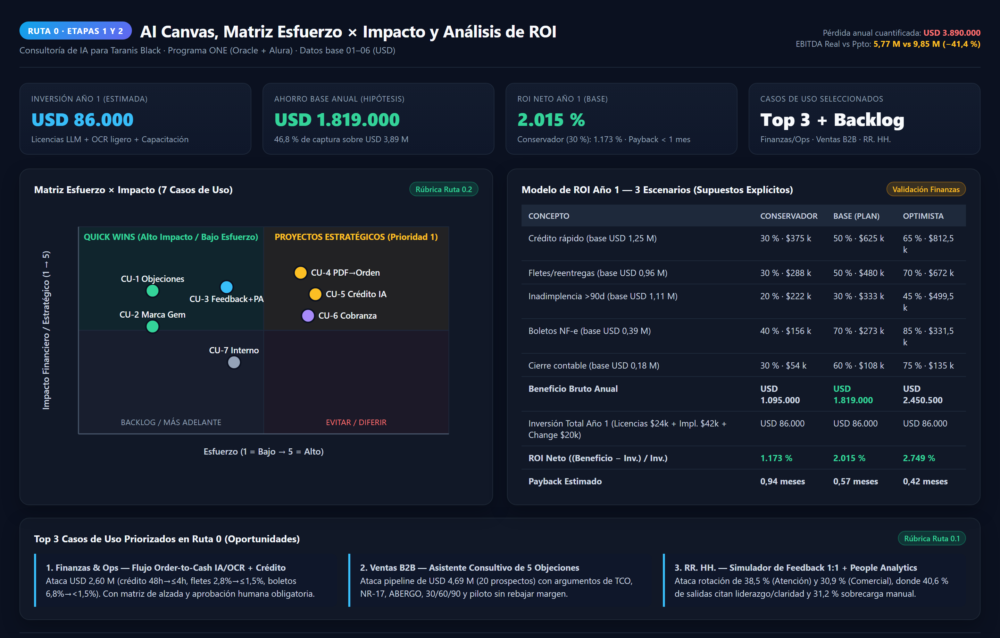

### Ruta 4 · Finanzas y Operaciones: SIPOC + Ishikawa 6M + Panel P&L
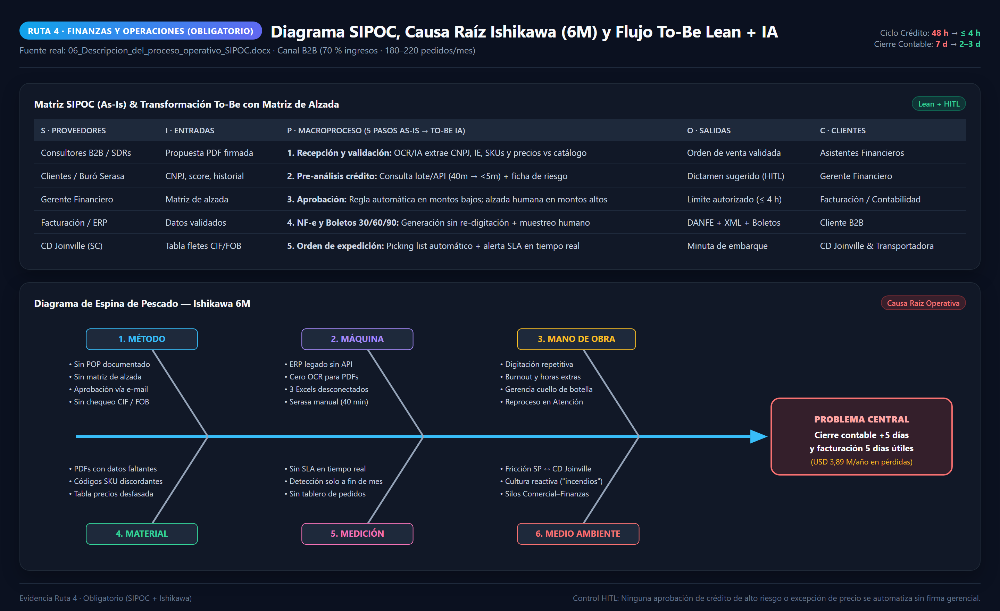
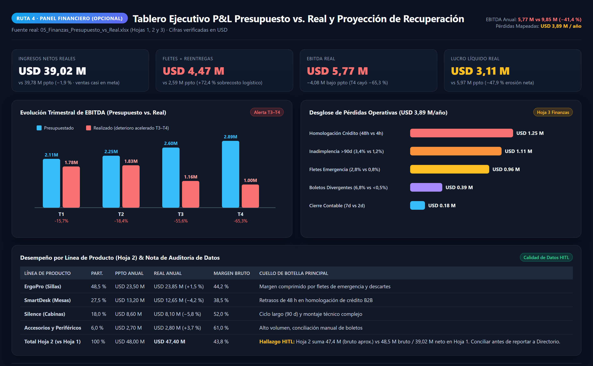

### Rutas 1, 2 y 3 · Ventas, Marketing y RR. HH. (Simulador de Feedback + People Analytics)
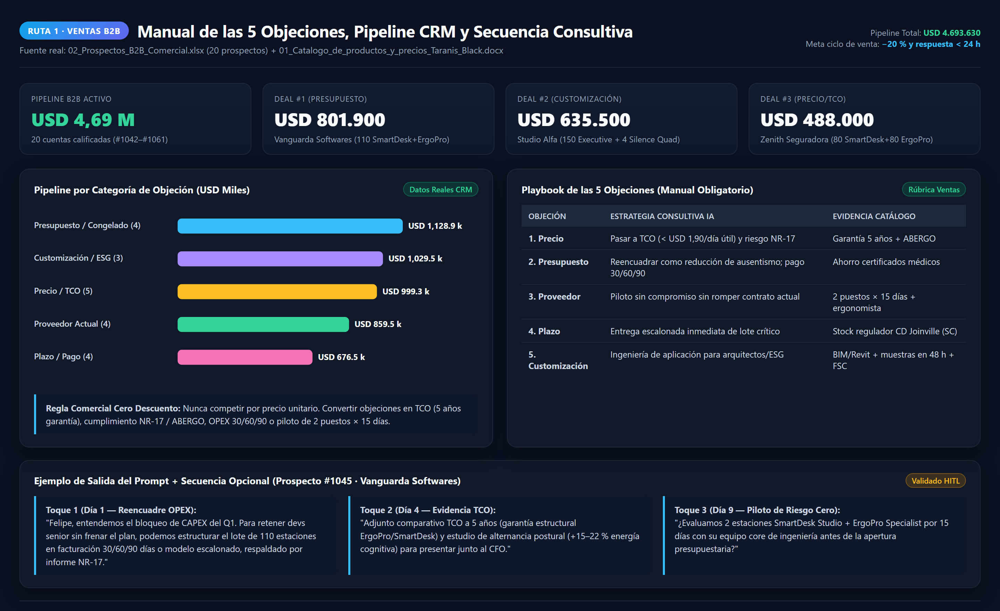
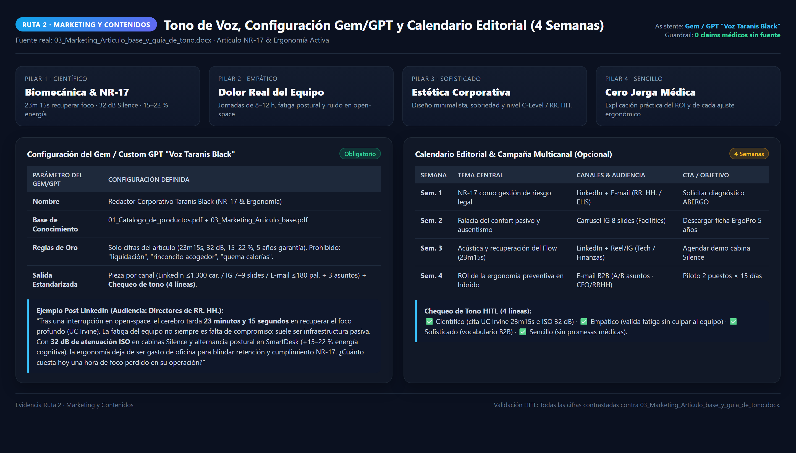
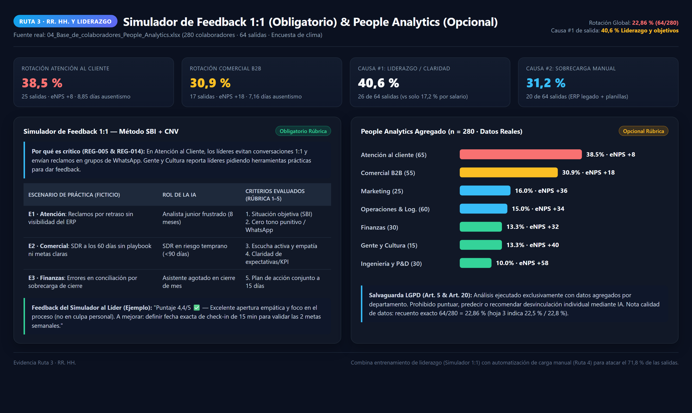

### Evidencias y Auditoría Human-in-the-Loop (HITL)
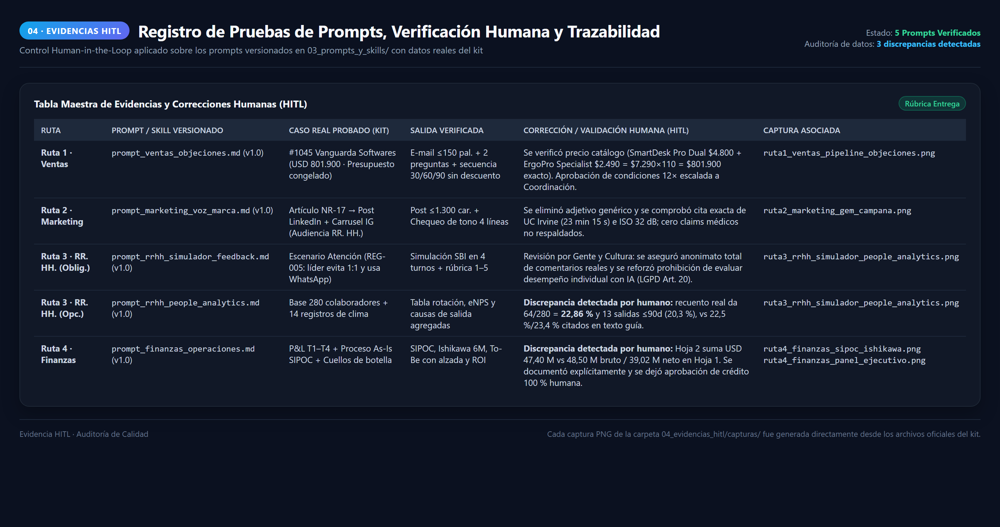

### Vistas de arquitectura por herramienta (Canva, Trello, n8n y Magnus BI)
*Prototipos visuales construidos con los datos reales del kit Taranis Black para mostrar el flujo operativo de punta a punta:*
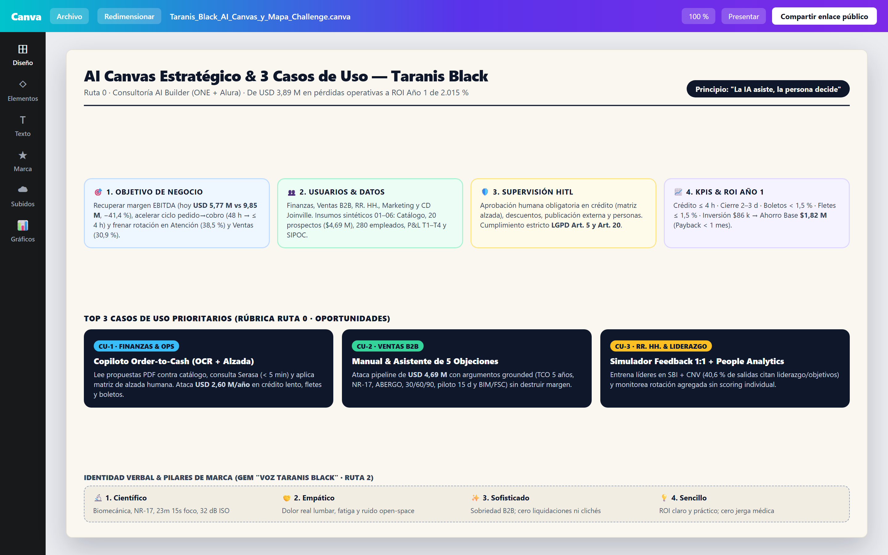
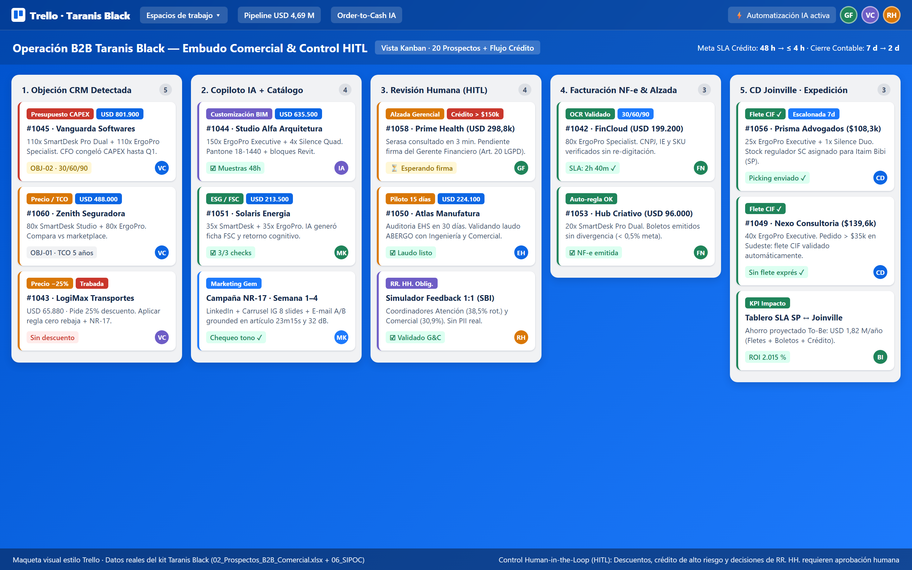
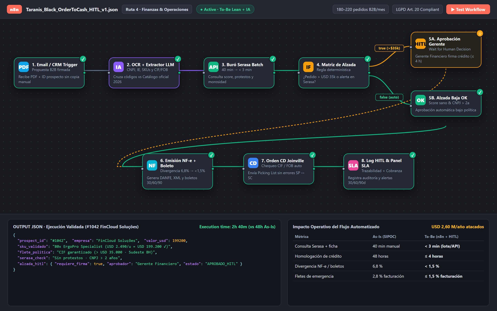
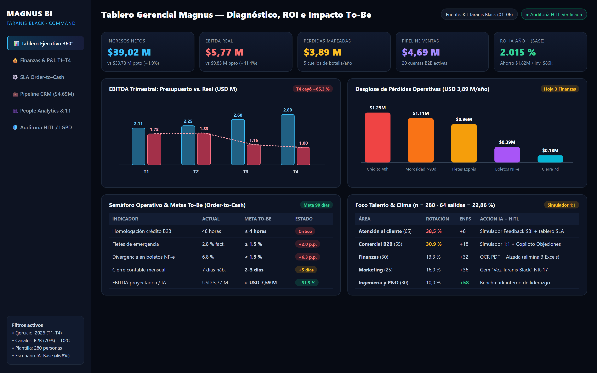

---

## Índice navegable

- **Kit de datos originales:** [`00_kit_datos_originales/`](./00_kit_datos_originales/README.md) ([Índice](./00_kit_datos_originales/00_Indice_y_guia.md), [Catálogo](./00_kit_datos_originales/01_Catalogo.md), [Prospectos](./00_kit_datos_originales/02_Prospectos.md), [Marketing](./00_kit_datos_originales/03_Marketing.md), [Colaboradores](./00_kit_datos_originales/04_Base_de_colaboradores.md), [Finanzas](./00_kit_datos_originales/05_Finanzas.md), [SIPOC](./00_kit_datos_originales/06_Descripcion_del_proceso.md))
- **Ruta 0 (Base estratégica):** [`01_ruta_0_base_estrategica/`](./01_ruta_0_base_estrategica/README.md) — [Etapa 1: AI Canvas](./01_ruta_0_base_estrategica/etapa_1_ai_canvas/ai_canvas.md) · [Etapa 2: Matriz y ROI](./01_ruta_0_base_estrategica/etapa_2_matriz_impacto/matriz_esfuerzo_impacto.md) · [Etapa 3: Gobernanza LGPD](./01_ruta_0_base_estrategica/etapa_3_gobernanza_lgpd/politica_gobernanza_etica_lgpd.md)
- **Verticales de especialización:** [`02_vertical_especializacion/`](./02_vertical_especializacion/README.md) — [Ventas](./02_vertical_especializacion/etapa_1_obligatoria/ruta_1_ventas.md) · [Marketing](./02_vertical_especializacion/etapa_1_obligatoria/ruta_2_marketing.md) · [RR. HH.](./02_vertical_especializacion/etapa_1_obligatoria/ruta_3_rrhh.md) · [Finanzas](./02_vertical_especializacion/etapa_1_obligatoria/ruta_4_finanzas_operaciones.md) · [Extensiones opcionales](./02_vertical_especializacion/etapa_2_opcional/extensiones_opcionales.md)
- **Prompts y Skills versionados:** [`03_prompts_y_skills/`](./03_prompts_y_skills/README.md)
- **Evidencias HITL y Capturas:** [`04_evidencias_hitl/`](./04_evidencias_hitl/README.md) · [Checklist de entrega](./04_evidencias_hitl/checklist_entrega.md)
- **Informe Ejecutivo y Video Pitch:** [`05_informe_ejecutivo/`](./05_informe_ejecutivo/informe_ejecutivo_google_docs.md) · [Guion Video ≤ 5 min](./05_informe_ejecutivo/guion_video_5min.md)

## Enlace al informe ejecutivo (Google Docs)

Copia el contenido de [`05_informe_ejecutivo/informe_ejecutivo_google_docs.md`](./05_informe_ejecutivo/informe_ejecutivo_google_docs.md) en tu plantilla oficial de Google Docs, agrega los pantallazos de `04_evidencias_hitl/capturas/` y reemplaza el enlace inferior con tu URL pública (permiso *Lector* probado en incógnito):

- [Informe Ejecutivo — Google Docs (pegar enlace público aquí)](https://docs.google.com/)

## Estructura del repositorio

```text
.
├── .gitignore
├── README.md
├── 00_kit_datos_originales/
├── 01_ruta_0_base_estrategica/
│   ├── etapa_1_ai_canvas/
│   ├── etapa_2_matriz_impacto/
│   └── etapa_3_gobernanza_lgpd/
├── 02_vertical_especializacion/
│   ├── etapa_1_obligatoria/
│   └── etapa_2_opcional/
├── 03_prompts_y_skills/
├── 04_evidencias_hitl/
│   ├── README.md
│   ├── checklist_entrega.md
│   └── capturas/                # 12 pantallazos PNG de alta resolución (incl. vistas Trello, n8n, Magnus y Canva)
└── 05_informe_ejecutivo/
    ├── informe_ejecutivo_google_docs.md
    └── guion_video_5min.md
```
